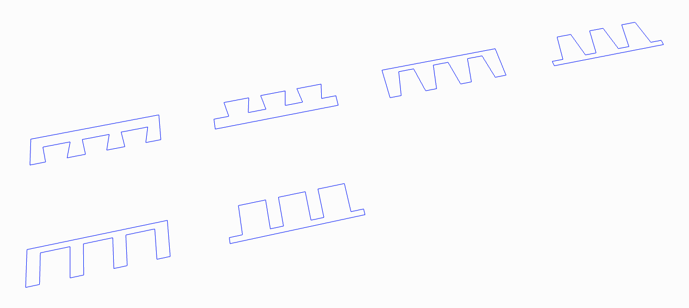
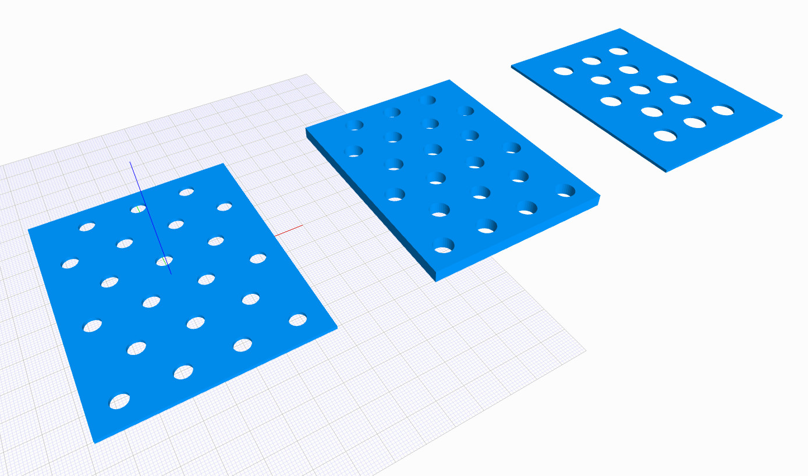
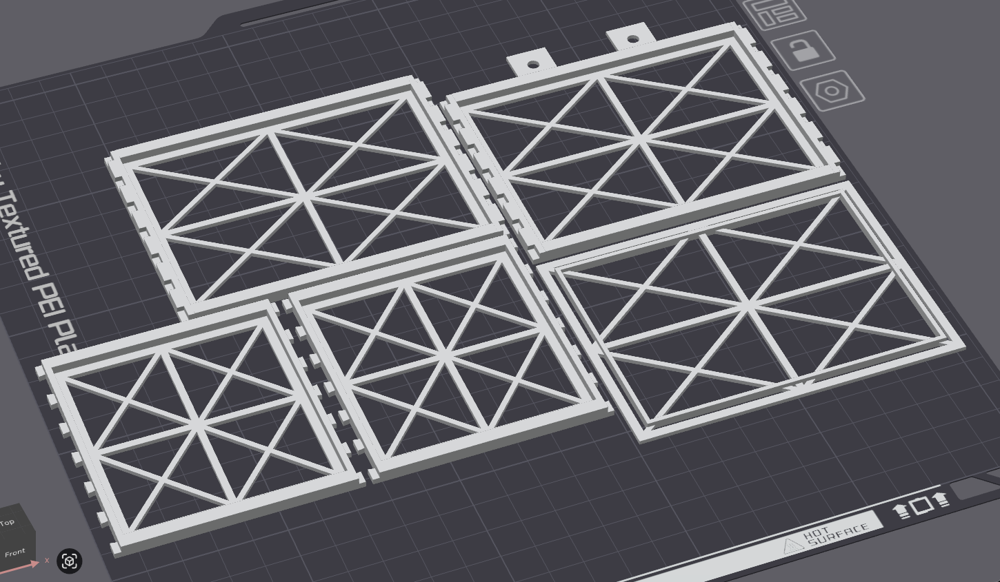
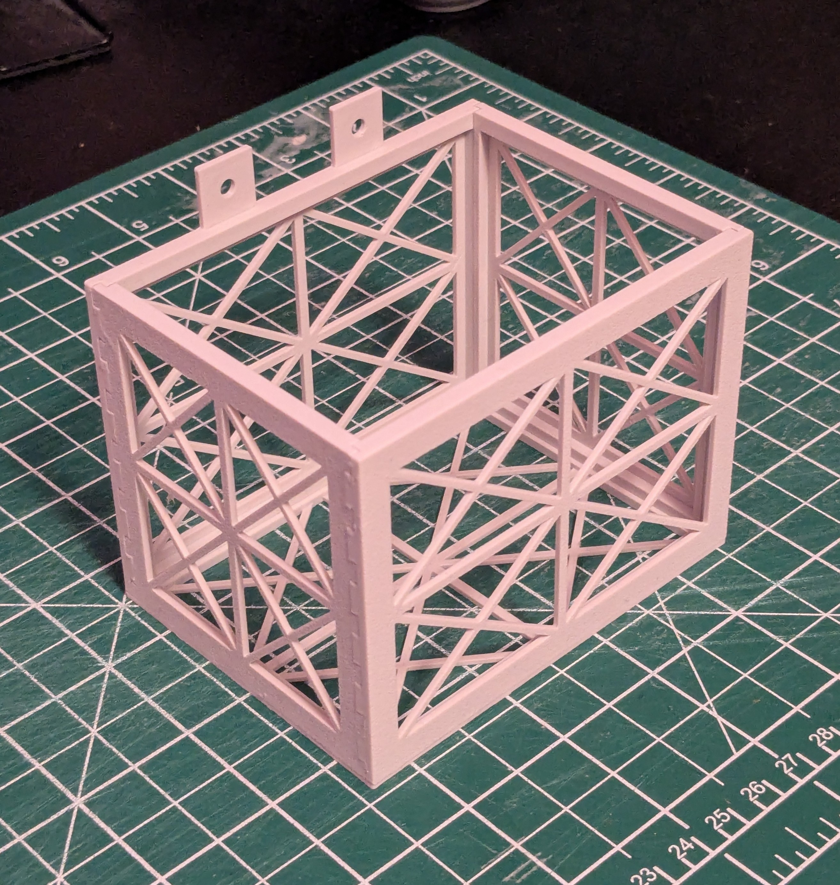
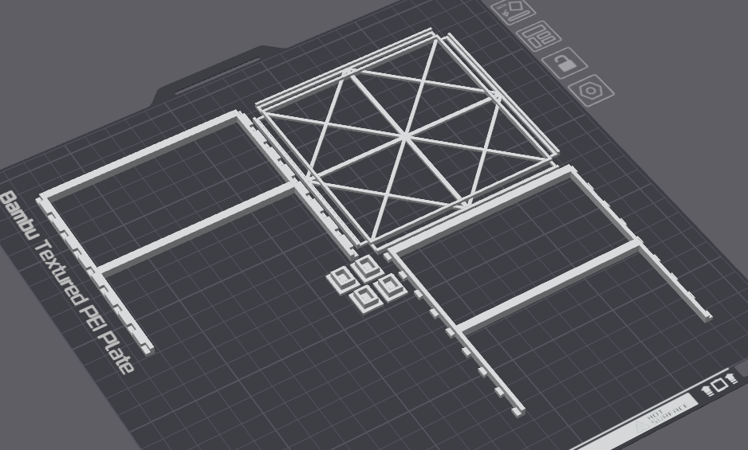
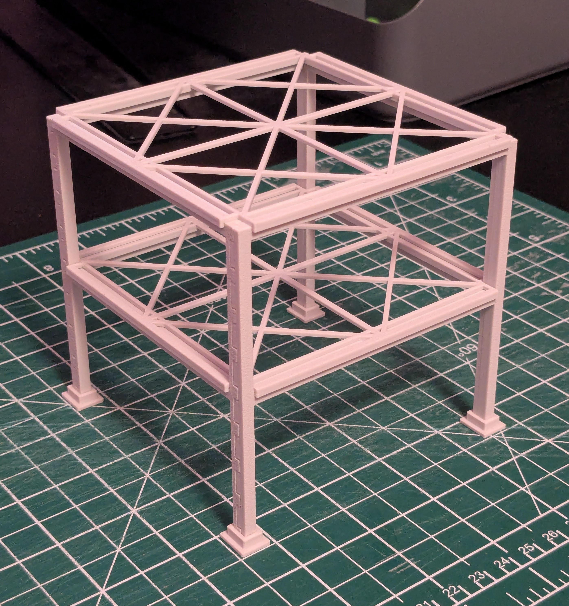
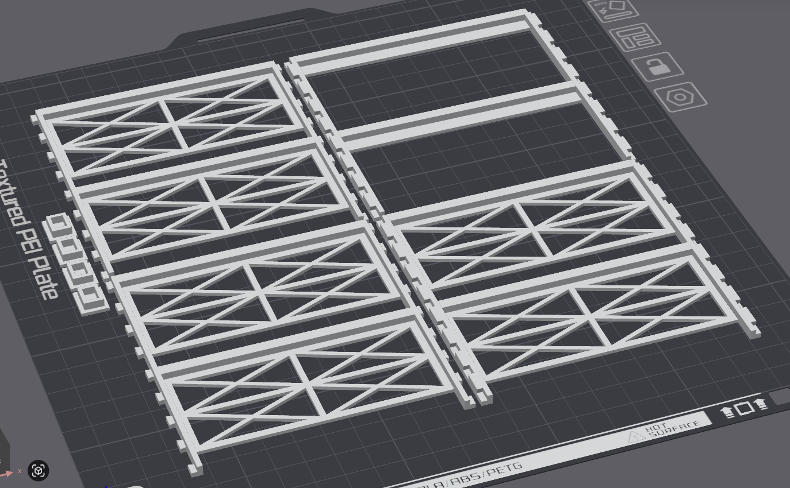
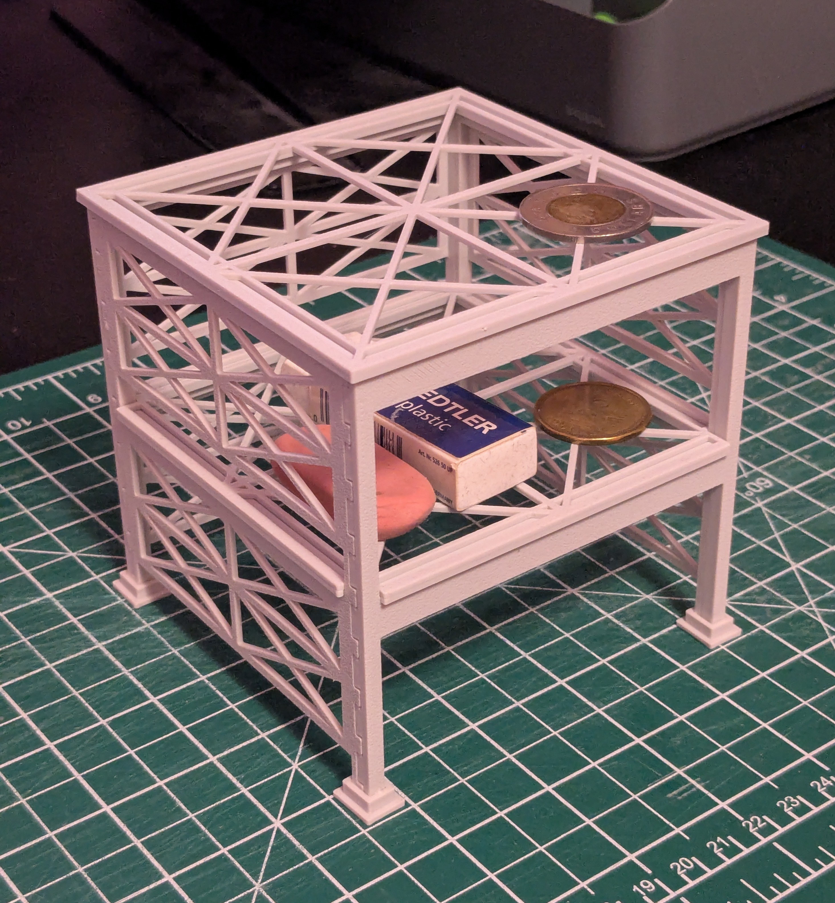
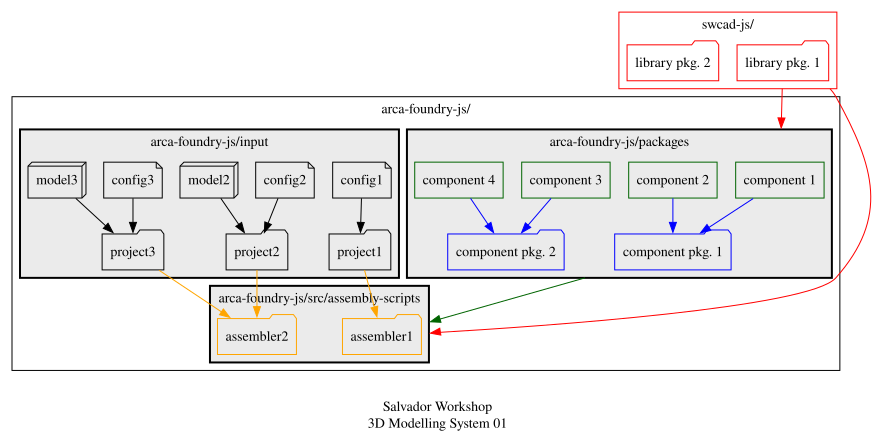

I've had a interest in drawing and technical drafting for since childhood and high school, and more recently picked up an interest in 3D modelling. And it didn't take long for me to wonder if I can generate models through code.

## Goals

These projects were built with two main goals in mind:

1. Parametric 3D modelling with code
1. Modelling for 3D printing

As an experienced developer having worked with JavaScript for several years, I found JSCAD to be an attractive option for this type of work. After spending the spring/summer of 2025 on trying to build a library (`sw-jscad`), I found that approach to be insufficient for building the larger and more complex models that I wanted.

After reworking that prototype library into `swcad-js` and trying different ways of generating those models, the current approach became the favoured design.

## Outcomes

This endeavour led to the development of two related software projects:

### swcad-js

`swcad-js` is a JavaScript library with functions for producing 2D/3D models through JSCAD, plus some "quality of life" utilities.





### arca-foundry-js

`arca-foundry-js` is a parametric builder for printable component kits. It's centred around a component library built using `swcad-js`. As a proof-of-concept, I've designed several types of organizers. The models for which are generated as a kit, to be printed and assembled into the final product.













### Known issues

This may just be the result of my _"skill issues"_, but several of the output models have issues with _"non-manifold edges"_, and require some cleanup to be printed out. See utilities such as <https://www.formware.co/onlinestlrepair>.

## Structure

In this system, `swcad-js` handles the generation of sub-components that are used to create `arca` components and packages.

In turn, those `arca` components are used by "assembler" scripts to implement an object design, and generate component kits informed by user parameters.



Splitting the functionalities proved useful. So the functions in `swcad-js` could be more generic in purpose, and provide sub-components to be shared across different model types. While `arca-foundry-js` produces specific components in specific arrangements, and act as the main user interface for passing in relevant parameters

## swcad-js

**Online viewer**  
<https://sw-jscad-viewer.netlify.app/>  
A heavily customized version of the JSCAD UI (<https://github.com/hrgdavor/jscadui>)

**API Docs**  
<https://salvador-workshop.github.io/swcad-js/>

**Repository**  
<https://github.com/salvador-workshop/swcad-js/>

**NPM package**  
<https://www.npmjs.com/package/swcad-js>

### Main goals & focus points

1. Component reuse.
1. Making complex modelling simpler, by encapsulating that complexity.
1. Making verbose JSCAD patterns simpler to implement, by encapsulating that verbosity.
1. Learning how to create a software library, complete with docs, demos, etc.

### Evolution

This project evolved through three phases:

**2025 Q1/Q2 - Ambitious Random Collection (`js-swcad`)**  

Essentially a collection of whatever cool JSCAD functions I could write. Not really tailored to particular use cases, though I did try to make some organizers and jigs for making small items at home. If it looked cool, it went in. The various library packages were also split into several repositories, making development a bit irritating at times.

**2026 Q2/Q3 - Ambitious Reworked Collection (`swcad-js <0.14.6`)**

Having refactored `js-swcad` into a monorepo, I then set out to improve this library's usability. I got into the habit of working iteratively, setting up roadmaps for each minor/patch version. Gradually tweaking and adding functionality over a few months. However, there wasn't a cohesive feel to the functions. With many functions being impractical for 3D printing, or having inconsistent usage styles.

**2026 Q4 - Focused Collection (`swcad-js 0.14.6 to 1.0.0`)**

After three and a half months away from the project, I had some time to rethink my approach. Mainly by focusing on the use cases the project would be good for, and eliminating the rest. And seriously thinking about the API for the library. A lot of "trimming the fat" happened from v0.14 onwards, and it clearly enabled the next phase of this 3D modelling work.

## arca-foundry-js

**Repository**  
<https://github.com/salvador-workshop/arca-foundry-js>

### Main goals & focus points

1. Interface for generating printable component kits
1. Contain a component library allowing parts to be shared between various designs

### Evolution

This project's evolution ran in parallel to `swcad-js` development:

**2026 Q1/Q2 - Random Collection**

This stage is where I first had the idea to set up a separate project to use `sw-jscad`/`swcad-js` to build more complex models, instead of doing it all in the main library. Mostly organized by model type, but without a consistent way of doing things. And not really thinking of combining these complex models together into an assembly.

**2026 Q4 - Focused Collection**

I returned with fresh eyes after some time away from this project and after some solid progress on `swcad-js`. Reorgnized the useful parts into several packages in a monorepo. Then set up scripts that allow models to be generated for various use cases, but still using the same input process.

I settled for an approach with inputs organized into folders _(see architecture diagram above)_. Each project requires a `config.json` which looks like:

```json
{
    "type": "basicBox",
    "metadata": {
        "name": "Demo: Simple Box 01",
        "id": "SBX",
        "serialNumber": "0001"
    },
    "parameters": {
        "length": 101.6,
        "width": 76.2,
        "height": 76.2
    }
}
```

This is where the user would enter paramters to customize the kit generated by that assembler `type`.

The "mould" functionality requires an STL file (`model.stl`) in the same input folder, which creates a mould around that model. And future functions involving SVG files would do something similar.

The metadata info isn't used yet, but future versions may engrave the metadata on the model somehere.

## Lessons Learned

### Define library scope and core functionality ASAP

In these projects, I feel like I spent a lot of time coding in circles without well-defined goals. Or working towards goals that didn't make much sense in the end. This resulted in a lot of code that had to be cut out, and a lot of reworking to make things more standardized to fit the newly defined scope.

If I had to make a software library again, this would be one of the key initial pieces I'd focus on. It also allows for better planning in other projects that depend on the library under development.

### Define standard API I/O style ASAP

In a similar note, the early projects' various functions sometimes had different input/output styles (especially the ones written first). This resulted in a lot of rework. Which gets irritating once there were docs already written for those pieces.

If I had to do this kind of work again, this would be high on the priority list.
